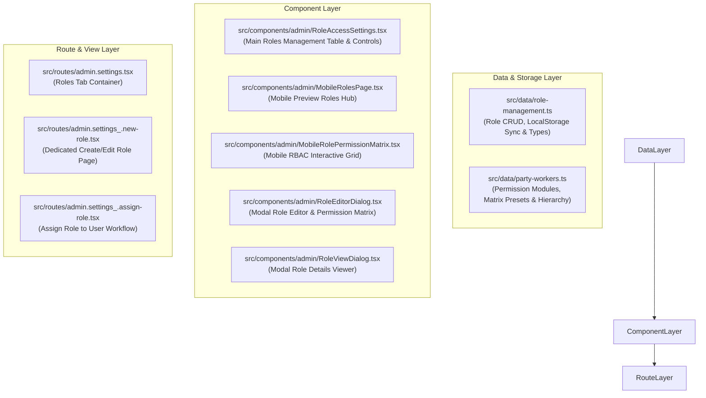
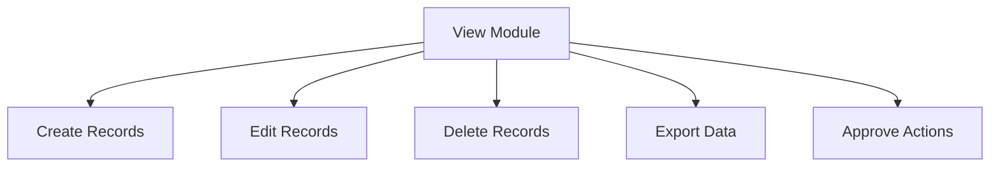
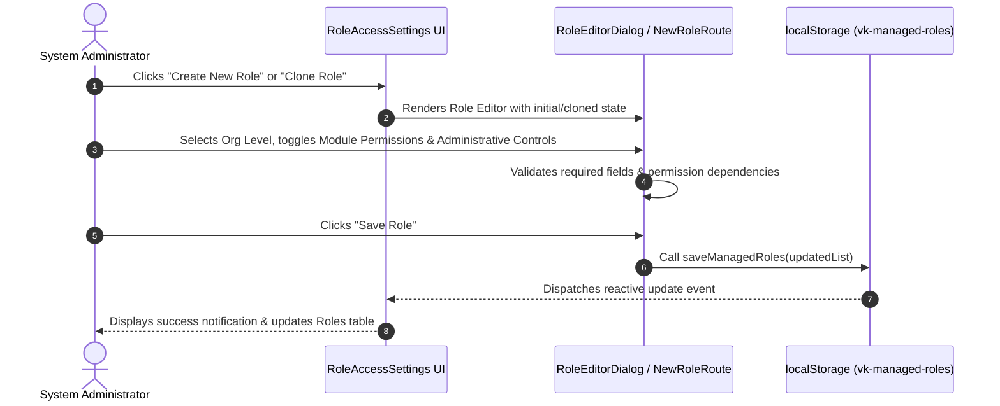

# Technical & Architecture Documentation: Roles & Access Control Module
**System**: Vikasita Keralam Platform (Admin Web & Mobile App Preview)  
**Document Version**: 1.0.0  
**Author**: Development Team  
**Last Updated**: November 12, 2026  

---

## 1. Executive Summary & Overview

The **Roles and Access Control Module** (RBAC & ABAC Architecture) provides granular, hierarchy-aware authorization across all organizational levels of the Vikasita Keralam platform. It enables administrators to create, configure, clone, and assign customizable roles, set module-level permissions (CRUD actions + view scopes), define administrative control privileges, and enforce strict organizational boundaries (State, District, Mandalam, Area, Booth).

---

## 2. Technical Architecture & File Directory Structure



### Core File Reference

| Module / File Path | Purpose / Description | Key Symbols & Handlers |
| :--- | :--- | :--- |
| [`src/data/role-management.ts`](file:///d:/Vikasita-Keralam/src/data/role-management.ts) | State management engine, storage keys, fallback presets, and custom organizational level handlers. | `loadManagedRoles()`, `saveManagedRoles()`, `ManagedRole`, `AdministrativePermissionId` |
| [`src/data/party-workers.ts`](file:///d:/Vikasita-Keralam/src/data/party-workers.ts) | Defines baseline permission modules, prerequisites, designations, and preset templates. | `permissionModules`, `rolePresets`, `permissionPrerequisites`, `roleOrganisationLevels` |
| [`src/components/admin/RoleAccessSettings.tsx`](file:///d:/Vikasita-Keralam/src/components/admin/RoleAccessSettings.tsx) | Desktop Admin Roles Management table view, filter bar, preset quick-adds, status toggles, and action dropdowns. | `RoleAccessSettings`, `handleToggleRoleStatus`, `handleDeleteRole` |
| [`src/components/admin/RoleEditorDialog.tsx`](file:///d:/Vikasita-Keralam/src/components/admin/RoleEditorDialog.tsx) | Dialog component for inline creation/editing of roles with real-time permission toggles. | `RoleEditorDialog`, `validateRoleForm`, `handleSaveRole` |
| [`src/components/admin/RoleViewDialog.tsx`](file:///d:/Vikasita-Keralam/src/components/admin/RoleViewDialog.tsx) | Read-only details viewer detailing administrative privileges, user count, and module matrix. | `RoleViewDialog` |
| [`src/components/admin/MobileRolesPage.tsx`](file:///d:/Vikasita-Keralam/src/components/admin/MobileRolesPage.tsx) | Mobile App Preview Roles Hub, listing active roles, assignment levels, and permission summaries. | `MobileRolesPage` |
| [`src/components/admin/MobileRolePermissionMatrix.tsx`](file:///d:/Vikasita-Keralam/src/components/admin/MobileRolePermissionMatrix.tsx) | Interactive mobile permission matrix viewer and editor. | `MobileRolePermissionMatrix` |
| [`src/routes/admin.settings_.new-role.tsx`](file:///d:/Vikasita-Keralam/src/routes/admin.settings_.new-role.tsx) | Full page route for creating and customizing new system roles. | `NewRolePage` |
| [`src/routes/admin.settings_.assign-role.tsx`](file:///d:/Vikasita-Keralam/src/routes/admin.settings_.assign-role.tsx) | Full page route for assigning roles to party workers & volunteers with boundary scoping. | `AssignRolePage` |

---

## 3. Data Models & Schemas

### 3.1 Managed Role Definition (`ManagedRole`)
```typescript
export interface ManagedRole {
  id: string;                                  // Unique identifier (slug or UUID)
  nameEn: string;                              // English Role Title
  nameMl: string;                              // Malayalam Role Title
  descriptionEn: string;                       // Role Description (English)
  descriptionMl: string;                       // Role Description (Malayalam)
  organisationLevel: AssignmentLevel;          // Org Boundary: 'state' | 'district' | 'mandalam' | 'area' | 'booth'
  designationScope?: PartyDesignation;         // Optional specific party designation binding
  presetId?: RolePresetId;                     // Linked preset template ID
  status: ManagedRoleStatus;                  // 'Active' | 'Inactive'
  assignedUserCount: number;                   // Dynamically calculated user count
  isSystemRole?: boolean;                      // Protects core system roles from deletion
  permissions: Record<PermissionModuleId, ModulePermissions>; // Permission matrix
  administrativePermissions?: AdministrativePermissionId[]; // ['manage_roles', 'assign_access', 'delegate_access']
  updatedAt: string;                           // ISO 8601 Timestamp
}
```

### 3.2 Module Permissions (`ModulePermissions`)
```typescript
export interface ModulePermissions {
  view: boolean;     // Read access to module assets
  create: boolean;   // Create new records
  edit: boolean;     // Edit existing records
  delete: boolean;   // Delete records
  export: boolean;   // Export reports/CSV
  approve: boolean;  // Approve workflows/applications
  scope: "all" | "assigned_only" | "district_only" | "mandalam_only" | "booth_only"; // Data boundary
}
```

---

## 4. Organizational Hierarchy & Permission Prerequisites

### 4.1 Organizational Levels
Roles are bounded to specific administrative tiers:
1. **State Level (`state`)**: Full state-wide visibility and administrative authority.
2. **District Level (`district`)**: Scoped to designated District boundaries (e.g. Thiruvananthapuram, Ernakulam).
3. **Mandalam Level (`mandalam`)**: Assembly constituency level scoping.
4. **Area / Local Level (`area`)**: Panchayat / Municipality / Corporation ward tier.
5. **Booth Level (`booth`)**: Polling booth level hyper-local scoping.

### 4.2 Permission Dependency Tree
The module automatically enforces permission prerequisites when toggling access:



* **Rule**: Toggling off `View` automatically revokes `Create`, `Edit`, `Delete`, `Export`, and `Approve`.
* **Rule**: Enabling `Create`, `Edit`, or `Approve` automatically forces `View` to `true`.

---

## 5. Storage & Persistence Protocol

* **Primary Key**: `vk-managed-roles` (Browser `localStorage`)
* **Custom Org Levels Key**: `vk-custom-organisation-levels`
* **Fallback Strategy**: On fresh session or missing storage, `loadManagedRoles()` automatically seeds the system with 8 core pre-configured templates (e.g., *State Admin*, *District President*, *Mandalam Convener*, *Booth Volunteer*, *Helpdesk Operator*).

```typescript
export function loadManagedRoles(): ManagedRole[] {
  if (typeof window === "undefined") return initialManagedRoles;
  try {
    const raw = window.localStorage.getItem(managedRolesStorageKey);
    if (!raw) return initialManagedRoles;
    return JSON.parse(raw);
  } catch {
    return initialManagedRoles;
  }
}
```

---

## 6. Functional Workflows



---

## 7. Security & Governance Rules

1. **System Protected Roles**: Roles flagged with `isSystemRole: true` cannot be deleted to prevent locking out core platform administration.
2. **Administrative Access Scoping**:
   - `manage_roles`: Allows user to view, edit, and create system roles.
   - `assign_access`: Allows user to assign existing roles to workers within their own org level or lower.
   - `delegate_access`: Allows user to delegate temporary privileges to subordinate officers.
3. **Data Isolation**: API requests and database queries MUST respect the `scope` property (`district_only`, `mandalam_only`, `booth_only`) appended to the user's active role session.
